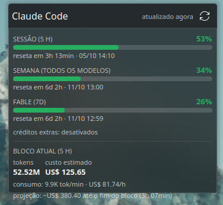
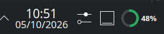

# Claude Usage for KDE Plasma

A native Plasma 6 widget that shows how much of your Claude Code subscription limits you have used: the 5-hour session window, the 7-day window, the per-model weekly window (Fable), and what the current 5-hour block is costing. It never polls Anthropic in a loop and never touches your OAuth refresh token.

[Leia em português](README.pt-BR.md)

<p align="center">
  
  &nbsp;&nbsp;
  
</p>

## Why this exists

Most "Claude usage" widgets poll the undocumented `api.anthropic.com/api/oauth/usage` endpoint every minute. That endpoint rate-limits **per account**, the block can last hours, and some tools then fall back to running `claude -p /cost`, which hits the same endpoint and leaves an empty session file behind on every run. I had 242 of those in one project folder before writing this.

Since Claude Code 2.1.80, the status line already receives `rate_limits` on stdin with every refresh. This project turns that into the primary data source and keeps the API as a rare fallback.

## How it works

```
Claude Code ──statusLine stdin──▶ claude-statusline-wrapper.sh ──▶ your status line (unchanged)
                                        │
                                        └─▶ statusline_capture.py ──┐
                                                                     ├─▶ ~/.cache/claude-usage/usage.json
systemd timer (5 min) ──▶ collector.py ─────────────────────────────┘             ▲
   ├─ oauth/usage API only if the cache is stale (≥10 min, with jitter,           │ read every 30 s
   │  honoring Retry-After and ccstatusline's own lock)                           │
   └─ ccusage blocks --active only while a session is running                     │
                                                           plasmoid (QML) ────────┘
```

- **Status line wrapper**: a tiny shell script registered as Claude Code's `statusLine` command. It records `rate_limits` into the cache and pipes the same JSON to whatever status line you already use (ccstatusline, a custom script, anything).
- **Collector**: a oneshot Python script run by a systemd user timer. It calls the usage API at most every 10 minutes, only when the cache is stale, backs off on 429 (5 min to 1 h, honoring `Retry-After`), and never refreshes the OAuth token. It also runs [ccusage](https://github.com/ryoppippi/ccusage) for the current block, only while a session is active.
- **Plasmoid**: reads the cache file and nothing else. Compact ring in the panel, full popup with bars, countdowns, a burn-rate forecast and the current block's tokens and cost. Colors follow your Plasma color scheme.
- **Notifications**: desktop notifications at 90% and 100% of the session window and 90% of the weekly window, once per window, plus one when a window that hit 100% resets. Sent by the collector, so they work even without the widget on a panel.

## Requirements

- KDE Plasma 6 (tested on 6.6, Wayland), `kpackagetool6`, `systemd --user`.
- Python 3.9 or later (standard library only).
- Claude Code 2.1.80 or later with a Pro or Max subscription (`rate_limits` only exists for those).
- Optional: [ccusage](https://github.com/ryoppippi/ccusage) for the "current block" section; `notify-send` for notifications.

## Install

```bash
git clone https://github.com/rodrigobatista21/claude-usage-plasmoid.git
cd claude-usage-plasmoid
./install.sh
```

The installer:

1. copies the collector to `~/.local/share/claude-usage/` and the wrapper to `~/.local/bin/`;
2. installs and starts the `claude-usage-collector.timer` user unit;
3. points `statusLine.command` in `~/.claude/settings.json` to the wrapper, remembering your previous status line so it keeps running (a backup of `settings.json` is written next to it);
4. installs the plasmoid with `kpackagetool6`.

Then right-click a panel or the desktop, choose **Add Widgets...** and search for **Claude Usage**. Open a Claude Code session and the numbers appear within seconds.

To update, `git pull` and run `./install.sh` again, then `systemctl --user restart plasma-plasmashell.service` so Plasma reloads the QML.

## Configure

Right-click the widget > **Configure**:

| Setting | Default | What it does |
|---|---|---|
| Panel metric | Session (5 h) | Which window the ring in the panel shows |
| Show percentage | on | Number next to the ring |
| Current block | on | Tokens, cost, burn rate and projection from ccusage |
| Re-read cache every | 30 s | How often the widget reads the cache file |
| Consider stale after | 15 min | Marks data as old while a session is active |
| Cache file | `$HOME/.cache/claude-usage/usage.json` | Where the collector writes |

Collector timings live at the top of `collector/collector.py`.

## Check that it is working

```bash
# live collector decisions (one line each: skip / api: 200 / api: 429 -> backoff / ccusage: ok)
journalctl --user -t claude-usage-collector -f

# what the widget sees
jq . ~/.cache/claude-usage/usage.json

# force a refresh (same thing the widget's refresh button does)
systemctl --user start claude-usage-refresh.service

# run the widget standalone (needs plasma-sdk)
plasmoidviewer -a org.rodrigom.claudeusage -f planar
```

## Security notes

- The collector reads the access token from `~/.claude/.credentials.json` and only uses it for `GET /api/oauth/usage`. It never calls the token refresh endpoint: refresh tokens are single-use, and a second client racing Claude Code for them can log you out.
- The plasmoid has no network access at all. It runs `cat` on the cache file through Plasma's executable data engine.
- Nothing is sent anywhere else.

## Uninstall

```bash
./uninstall.sh
```

This restores your previous status line, disables the timer, removes the plasmoid and deletes the cache. Remove the widget from the panel if it is still there.

## Known limitations

- Widget strings are in Brazilian Portuguese. Translations are welcome.
- `rate_limits` shows up only after the first API response of a Claude Code session, so a fresh session takes a prompt or two before the widget updates. The collector covers the gap with the API when needed.
- Per-model windows (Fable today) come only from the API, so they refresh every 10 minutes, not every few seconds.

## Credits

- [ccusage](https://github.com/ryoppippi/ccusage) for the local block accounting.
- [ccstatusline](https://github.com/sirmalloc/ccstatusline) for showing that the status line payload was enough.

MIT License.
